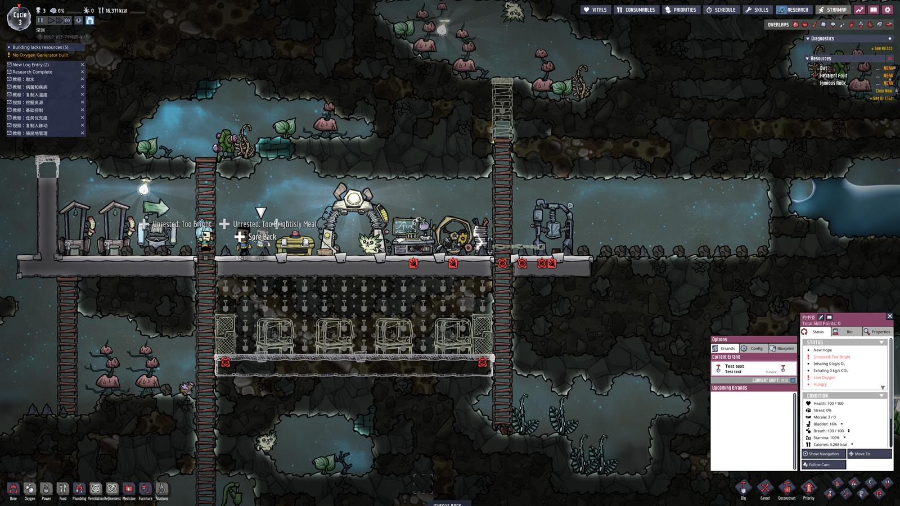

# 0.2.0 原版殖民地客机

适用 Windows Steam 基础游戏，Klei 744825，Steam build 24423041。房主及所有好友使用同一份包。主菜单的 Steam 邀请、房间号和开发 LAN 加入入口均进入原生加载流程。

截图来自真实 Unity 客机，取自在原版选择工具中选中复制人、打开详情侧栏的帧。右下差事面板仍可显示模板文字，复制人当前差事和全部个体统计尚缺实时同步。源图保存在本机运行 `game-8a822df4333e4022bcffdcffa0d78ac8` 的 `native-guest.png`，此处缩放为 1600×900 JPEG。此轮客机连接录制数据回放端。

## 下载安装及加入

1. 两人下载同一个 ZIP。本轮验收包为 98,618 字节，SHA-256 为 `4D770C98F3254B2A0478C8DA398AA3F69B5A8F4C87D114913549A607E2C892B1`。从独立检出的提交 `94ae391` 重新编译，得到相同字节数和 SHA-256。好友可在各自机器上用下面的命令核对。 [0.2.0 开发包](../../dist/QueyangCoop-0.2.0-dev.zip)
2. 退出游戏。下载了完整仓库时，用安装脚本预览目标，再运行安装命令。脚本安装到个人 Mods 目录下的 `dev/QueyangCoop`，替换既有开发包前会保存备份并输出路径。只有 ZIP 时，可将包内四个文件直接解压到“文档”下的 `Klei/OxygenNotIncluded/mods/Local/QueyangCoop`。选一种安装方式。 [安装脚本](../../tools/install-dev.ps1) · [恢复备份](../../tools/restore-dev.ps1)
3. 两端在游戏的 Mods 菜单启用 Queyang Co-op，按提示重启。本候选要求关闭 DLC 和其他启用的 Mod。房主载入 Vanilla 存档副本，在暂停菜单的“多人合作”中创建房间，邀请好友或复制房间号。客机从主菜单加入，需要等存档下载、校验、载入和首个权威视图完成。 [游戏内步骤与局域网配置](../../README.md)

~~~powershell
Get-FileHash .\dist\QueyangCoop-0.2.0-dev.zip -Algorithm SHA256
.\tools\install-dev.ps1 -Package .\dist\QueyangCoop-0.2.0-dev.zip -WhatIf
.\tools\install-dev.ps1 -Package .\dist\QueyangCoop-0.2.0-dev.zip
~~~

安装成功后应看到 `QueyangCoop.dll`、`Queyang.Core.dll`、`mod.yaml` 和 `mod_info.yaml` 四个文件。版本不符时，先核对游戏 build、两端 ZIP 哈希与启用的 Mod。LAN 模式默认绑定回环地址；第二台机器加入时，先按首页说明让房主绑定局域网地址。

## 房主与客机的分工

1. 房主在好友入房时，把正在运行的殖民地保存为独立网络快照。原有存档指针保留。临时目录与正常保存目录分开，快照分块发送，传输失败或结束后释放。
2. 客机校验整份文件的 SHA-256，加载临时副本进入 ONI 的原版场景。客机需要一次零时间步来绑定原生网格缓冲区。正常推进物理、AI、任务、存档和成就的职责由房主承担。
3. 各自的相机位置和缩放决定订阅哪些区域。中心订阅持续取增量，周边地块另行补取。工具使用游戏原有的输入入口，提交给房主校验。客机收到房主状态后刷新地形、施工、复制人和当前可见的资源。
4. 退房使用游戏原生流程返回菜单，释放会话和临时副本。重新加入会下载房主当时的存档。

## 当前验收矩阵

以下记录区分真实游戏房主、真实游戏客机和协议测试端。2026-11-22 的房主录制编号为 `game-9ad6d3e02b7543ca8aaefdad8e9ac24b`，客机回放编号为 `game-8a822df4333e4022bcffdcffa0d78ac8`。运行目录位于本机 `artifacts/qa`。测试驱动、判定条件和目标编号可在仓库中核对。 [房主检查](../../tests/Integration/Game/NativeManagementChecks.cs) · [客机检查](../../tests/Integration/Game/NativeScenario.cs) · [计划验收条件](../05-verification.md)

房主录制、原生存档读回与单账号 Steam 回归来自上一份开发包。待本轮长稳结束后，再用本页哈希所列包复核房主与 Steam 路径。双账号邀请与双机并发操作仍待验收。

| 项目 | 已取得的证据 | 仍待验收 |
|---|---|---|
| T01–T03 协议、并发、初始下载 | 核心测试 35 项全部通过。覆盖多客机争抢、迟到和重复命令、大快照、校验失败、断线清理、重新加入、慢端窗口，以及周边分块传输期间中心操作可用。 | 真实跨网传输大后期殖民地的载入时间和带宽。 |
| T04 原版客机隔离 | 独立 Unity 客机加载 3 名复制人的存档。关房前统计为 `simStep=0 findChore=0 setChore=0 saveAttempts=0 worldStarts=0 views=4 replicaStarts=1 gridBindings=1`。最后两项记录了一次授权副本初始化和一次零时长缓冲绑定。 | 两台真实游戏同时运行时，跨长时间、频繁切速和退房的隔离计数。 |
| T05 镜头、叠层、选择 | 客机镜头平移 2 格，温度叠层成功启用，选中复制人后读取到正确的原版详情侧栏目标。 | 不同屏幕比例、缩放及大范围连续平移下的周边刷新延迟。 |
| T05 房主施工 | 正在运行的 Unity 房主接收协议测试端下达的挖掘和梯子订单。日志记录挖掘标记、施工蓝图、地块挖通、梯子完成，另录制梯子拆除及取消所需的菜单数据。 | 所有建筑、朝向组合、自动化和非直线路径的逐项施工。 |
| T05 客机施工与菜单 | 原版 DigTool 的鼠标按下、抬起路径产生命令，回放端收到坐标 `120,192`。客机显示挖掘标记，随后标记消失，地块从火成岩变成氧气。测试通过原生 KButton 先后点击梯子的“指派拆除建筑”和“取消拆除建筑”，双方记录了相应命令与回执。 | 同一时刻由两名真人在不同视区下单、在资源竞争中撤销或改令。 |
| T05 殖民地管理 | 房主端实测研究、排班、个人优先级和建筑启停命令操作真实殖民地。客机端已接入相应原版管理界面；仓储过滤与生产配方有专用同步路径。 | 在两台设备上逐项点击客机管理面板，同时观察房主效果与回传显示。 |
| T05 环境、管网、库存 | 已实现格子元素、质量、温度、可见性、管线内容、电力及逻辑字段、地面矿堆与库存摘要采样。回放确认了目标格挖掘后的元素、质量、温度。 | 各种管网拓扑、高密度堆叠、复制人迁移、所有叠层与资源侧栏长时比对。 |
| T06 网络故障 | 自动测试覆盖损坏的下载、超时、断开、重连及慢端。开发 LAN 上的真实游戏房主和真实游戏客机分别完成传输。 | 原生客机在真实 WAN 抖动和长掉线下反复重进，观察健康客机和房主帧率。 |
| T07 Steam 好友局 | 已有单账号 Steam 房间、元数据和原生回环检查记录。 | 两个独立 Steam 账号实际覆盖层邀请、接受、退房及重邀。 |
| T08 四人和长稳 | 历史 0.1.0 有一小时真实房主加三个 TCP 协议端记录。 | 0.2.0 的四个真实 Steam 玩家、并发重连和跨机 60 分钟验收。 |
| T09 原生存档 | 房主手动保存 772,530 字节的原版档，卸载联机程序集后由干净游戏载入并核验排班标记。真实原生客机通过退房返回主菜单。 | 中后期档的多轮客机退出、单人恢复及跨自动保存联测。 |
| T10 安装与分发 | 最终包独立重编的 SHA-256 一致，隔离目录安装及回滚复测通过。真实客机使用隔离游戏目录完成上述回放。 | 好友从空目录安装后的双账号完整联机。 |
| T11 非法操作与权限 | 房主实测拒绝越界和非房主时钟、保存操作。近端写保护覆盖打印舱、技能、时钟、存档、未接入工具与专用侧栏，客机显示提示。 | 手柄和各侧栏控件逐项回归，检查拒绝提示和房主状态保持。 |

房主单视口热采样 20 次，捕获加编码的主线程 p95 为 0.73 ms，最大载荷为 19,722 字节。本记录使用小型测试档，只测这条采样路径。整帧开销、三名客机同时平移的带宽与长期队列变化需要单独测量。 [网络实测](qa/network-runtime.md) · [历史长稳](qa/soak.md)

本轮真实客机在选中梯子后退房并返回菜单。此前侧栏在建筑投影销毁后访问目标，引发 `SimpleInfoScreen.RefreshMovePanel` 空引用异常。本轮 `guest-native.report` 记录 PASS，`guest-native.log` 未发现该异常。

10 MiB 原生文件的参考链路使用真实 TCP 回环和固定种子的合成文件，每个方向限速 20 Mbit/s，人工加入 150 ms 往返时延。两次从连接、下载、SHA-256 校验到首个视图 Live 分别为 **10.111 秒和 10.112 秒**，均低于夹具的 15 秒目标。夹具用就绪回调模拟游戏加载完成；玩家的实际加入时间还包含房主保存真实殖民地，以及客机在 Unity 中反序列化、初始化和渲染的耗时。 [传输夹具](../../tests/Integration/Transport/LateJoin.cs)

~~~powershell
dotnet run --project tests/Integration/Transport/TransportTests.csproj -c Release -- --native-save
~~~

## 实测方法

先用真实游戏房主与 TCP 记录端运行。记录端通过生产协议接收入房快照，向真正的殖民地下挖掘与建造命令，记录房主执行前、执行中和完成后的显示数据。然后关闭房主，启动独立的真实 Unity 客机，连接读取上述数据的回放端。该夹具允许在一台只有一个 Steam 登录的电脑上分别检查房主执行和客机渲染、输入、退出。

~~~powershell
$sourceSave = Read-Host '输入 Vanilla 测试用存档完整路径'
.\tests\Integration\Game\run.ps1 -NativeRecord -Persistence -SavePath $sourceSave -TimeoutSeconds 180
~~~

将第一步输出的 Run directory 下的 native-recording 路径填入下一条命令。该目录含私人存档，只保留在本机。成功时应得到客机截图、原版输入及宿主回执和返回菜单的 PASS 行。

~~~powershell
$recording = Read-Host '输入上一轮 native-recording 目录完整路径'
.\tests\Integration\Game\run.ps1 -NativeReplay $recording -TimeoutSeconds 180
~~~

双设备验证时，在第一台机器用测试存档副本开开发 LAN 房，第二台机器运行下方命令。测试驱动会实际请求在房主殖民地挖掘一格。两台机器也可使用相同 ZIP 启动游戏，通过好友邀请手工验证加入、平移、下单、退出和重邀。

~~~powershell
$hostEndpoint = Read-Host '输入测试房主的局域网 IPv4 地址和端口'
.\tests\Integration\Game\run.ps1 -NativeEndpoint $hostEndpoint -TimeoutSeconds 240
~~~

## 覆盖边界

基本工具、常规建筑以及已接入的研究、排班、优先级、仓储和生产设置通过房主执行。房主端使用正常的 ONI 审核或放置逻辑。打印舱选择、技能分配和复杂设备的专用设置属于房主操作范围。不同缩放下周边地块的刷新速度受视口数量和网络延迟影响。异形线路、病菌、装饰、动物/植物状态及全部特殊建筑组件仍缺少完整的实时镜像。

客机首次加入会接收完整的私人殖民地存档，单文件上限为 128 MiB；房主保存快照与双方游戏的原版载入均可能造成短暂停顿。只与信任的玩家交换存档。视口中心为 24×16 格，周边使用独立分块补取。受到更新频率限制，缩远后不同区块可能显示于不同采样时刻。房主离线后本局结束；原房主可载入自己的存档重新开房。当前组合限一颗 Vanilla 小行星、同一受支持构建和相同 Mod 程序集。

单账号 Steam 好友房和原生回环可在本机验证。跨账号覆盖层邀请、两台真实游戏同时操作以及四玩家跨机长稳仍需独立账号与设备。历史 0.1.0 主菜单格子客机的结果保留在[原型记录](status.md)。
